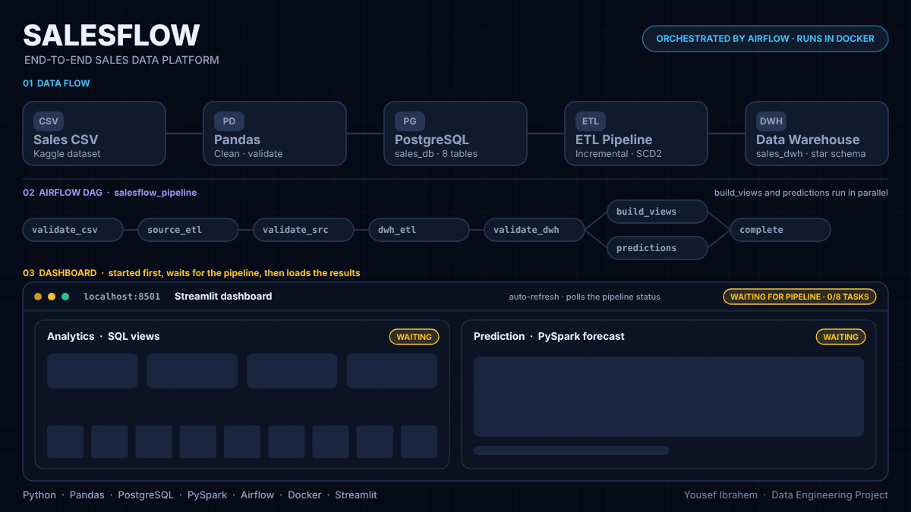
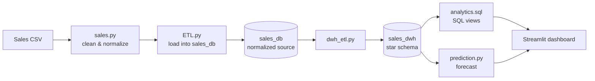

<div align="center">

# 🚀 SalesFlow


<p align="center">
  
</p>

<p>
  
  
  
  
  
  
</p>

<p>
  <b>ETL</b> · <b>Data Warehousing</b> · <b>SQL Analytics</b> · <b>Sales Prediction</b> · <b>Orchestration</b>
</p>

</div>

---


## 📌 Overview

**SalesFlow** is a data engineering and analytics project that transforms raw sales data into structured datasets for business analysis and reporting.

It combines Python, Pandas, PostgreSQL, PySpark, Streamlit, Airflow, and Docker to demonstrate data processing, validation, database integration, analytical SQL, orchestration, and interactive data visualization. The goal is a practical workflow that connects data preparation, storage, analytics, and prediction in one project, runnable either locally or with Docker.

## ✨ Key Features

| Feature | Description |
|---|---|
| 🔄 ETL Pipeline | Load, clean, and transform sales data. |
| 🗄️ PostgreSQL Integration | Store and manage structured data in a relational database. |
| 🏛️ Data Warehouse | Star schema with incremental loading and SCD Type 2 for customer and product dimensions. |
| ✅ Data Validation | Checks on the CSV, the source database, and the warehouse (including reconciliation against the source). |
| 📊 SQL Analytics | SQL views that support sales analysis. |
| 📈 Interactive Dashboard | Explore sales insights through Streamlit, with loading states while the pipeline runs. |
| 🤖 Prediction Workflow | PySpark model for line-item sales and a 3-year revenue/profit forecast. |
| 🌀 Orchestration | Airflow DAG that runs every stage in order and records its status. |
| 🐳 Docker | Airflow and the dashboard run as containers; PostgreSQL stays on your machine. |

## 🛠️ Technology Stack

- **Python**: core programming language
- **Pandas / NumPy**: data manipulation and numerical work
- **PostgreSQL**: relational database
- **SQLAlchemy / psycopg2**: database connectivity
- **PySpark**: prediction workflow
- **Streamlit / Plotly / Matplotlib**: dashboard and charts
- **Apache Airflow** (CeleryExecutor, Redis): pipeline orchestration
- **Docker / Docker Compose**: containerized Airflow and dashboard
- **SQL**: schema definition and analytical views
- **Git & GitHub**: version control and hosting

## 🖥️ Dashboard Pages

| Page | What it shows |
|---|---|
| Business overview & KPIs | Revenue, profit, orders, margin |
| Time trends | Monthly, quarterly, and yearly performance |
| Categories & products | Category, subcategory, product, and manufacturer breakdowns |
| Segments & regions | Customer segment and regional performance |
| Discount impact | Discount levels vs. profitability |
| Sales predictions | 3-year revenue and profit forecast, top products, CSV download |

The dashboard only **reads** the warehouse views. While the pipeline is still running it shows a progress page and refreshes by itself. The Prediction tab shows the forecast only when it belongs to the latest pipeline run.

## 🏗️ Project Structure

```text
SalesFlow/
├── dags/
│   └── salesflow_dag.py          # Airflow DAG
├── src/
│   ├── ETL.py                    # load the source database
│   ├── dwh_etl.py                # load the warehouse (incremental + SCD2)
│   ├── sales.py                  # read, clean, normalize the CSV
│   ├── analysis.py
│   ├── config.py
│   ├── dashboard.py
│   ├── prediction.py             # PySpark model + forecast
│   ├── visuals.py
│   ├── pipeline_checks.py        # data validation
│   ├── pipeline_stages.py        # one CLI entry per DAG task
│   ├── pipeline_status.py        # run status + forecast metadata
│   └── experiment_models.py      # read-only model comparison script
├── sql/
│   ├── analytics.sql
│   ├── dwh_schema.sql
│   └── pipeline_status.sql
├── data/
│   └── Sales_data (1).csv
├── prediction_outputs/           # forecast.csv, predictions.csv, metrics.json (generated)
├── docs/
│   └── images/
├── run_pipeline.py               # local one-command runner
├── docker-compose.yaml
├── Dockerfile.airflow
├── Dockerfile.dashboard
├── requirements.txt              # local runs
├── requirements-pipeline.txt     # pipeline environment inside the Airflow image
├── requirements-dashboard.txt    # dashboard image
├── README_DOCKER.md              # detailed Docker / Airflow guide
├── .env.example
├── .gitignore
└── README.md
```

## 🔄 Data Flow



## 🌀 Airflow DAG

The DAG `salesflow_pipeline` has no schedule (the source is a CSV file), runs one instance at a time, and has no automatic retries because the source load drops and recreates tables.

<p>
  
</p>

| Task | What it does |
|---|---|
| `validate_sales_csv` | Validates the CSV (columns, nulls, dates, numeric ranges, quantity, segment conflicts) and prepares the tables. |
| `source_etl` | Full load of `sales_db`. |
| `validate_source_db` | Schema, row counts, keys, orphans. |
| `dwh_etl` | Incremental load of `sales_dwh`. |
| `validate_dwh` | Keys, SCD2 rules, and reconciliation with the source (rows, orders, total sales and profit). |
| `build_views` | Runs `sql/analytics.sql` and checks the views exist. |
| `predictions` | Trains the model, writes the forecast and metrics, and validates the files. |
| `pipeline_complete` | Cleans temporary files. |

Each task writes its status to the `pipeline_run_status` table in `sales_dwh`:

```sql
SELECT * FROM pipeline_run_status ORDER BY started_at DESC;
```

## 🧭 Architecture & Data Model

**Source database (`sales_db`)** is normalized: `customers`, `manufacturers`, `categories`, `subcategories`, `products`, `locations`, `orders`, `order_items`.

**Data warehouse (`sales_dwh`)** is a star schema:

- **Fact table:** `fact_sales` (one row per order item): discount, quantity, sales, profit
- **Dimensions:** `dim_date`, `dim_customer`, `dim_product`, `dim_location`
- `fact_sales` references `dim_date` twice (order date and ship date)
- `dim_customer` and `dim_product` use SCD Type 2 (`effective_date`, `end_date`, `is_current`)

<details>
<summary><b>📂 View Data Source Overview</b></summary>


</details>

<details>
<summary><b>🗃️ View Sales Schema</b></summary>


</details>

<details>
<summary><b>🏛️ View Data Warehouse Schema</b></summary>


</details>

## 🚀 Getting Started

SalesFlow runs with **Docker Compose**. PostgreSQL stays on your machine.

### Prerequisites

- Docker with Compose (at least 6 GB of memory for Docker)
- PostgreSQL, with **two empty databases** of your choice: one for the source data and one for the warehouse
- The dataset at `data/Sales_data (1).csv`

### 1. Configure

```bash
cp .env.example .env
```

Edit `.env`:

| Variable | Description |
|---|---|
| `DB_PORT`, `DB_USER`, `DB_PASSWORD` | Your PostgreSQL connection |
| `SOURCE_DB_NAME` | Name of your source database (any name) |
| `DWH_DB_NAME` | Name of your warehouse database (any name) |
| `DOCKER_DB_HOST` | PostgreSQL host seen from the containers (default `host.docker.internal`) |
| `AIRFLOW_UID` | Linux/WSL: output of `id -u`. Windows/macOS: `50000` |
| `FERNET_KEY`, `AIRFLOW__API_AUTH__JWT_SECRET` | Airflow secrets (see `.env.example`) |
| `_AIRFLOW_WWW_USER_USERNAME`, `_AIRFLOW_WWW_USER_PASSWORD` | Airflow login |

**Never commit `.env`.**

### 2. Allow Docker to reach PostgreSQL

In `postgresql.conf` set `listen_addresses = '*'`, and in `pg_hba.conf` allow your user from the Docker network (for example `host all <db_user> 172.16.0.0/12 scram-sha-256`). Then restart PostgreSQL and allow port `5432` in the firewall.

### 3. Start

```bash
docker compose build
docker compose up airflow-init
docker compose up -d
```

| Service | URL |
|---|---|
| Airflow | http://localhost:8080 |
| Dashboard | http://localhost:8501 |

The dashboard starts right away and loads the results by itself once the pipeline finishes.

### 4. Run the pipeline

In Airflow, un-pause `salesflow_pipeline` and press **Trigger**.

### 5. Stop

```bash
docker compose down
```

## 🔮 Sales Forecast: Method & Limitations

`prediction.py` has two parts:

1. **Validation model:** a PySpark Gradient-Boosted Trees regressor predicts line-item sales, combined with a price rule. For products seen in training, `sales = price × quantity × (1 − discount)` using the product's average list price; for unseen products the GBT prediction is used (never below 0). Metrics are saved to `prediction_outputs/metrics.json` (`rmse`, `mae`, `r2` for the hybrid, plus `gbt_only_*` and `known_product_share`). This part checks how well the model learns the data and is **not** shown in the dashboard.
2. **Multi-year forecast (shown in the dashboard):** monthly totals are fitted with a linear trend plus month-of-year seasonality (least squares) and projected 3 years ahead.

Reference results from one run on the project data (random 80/20 split, seed 42):

| Metric | Hybrid | GBT only |
|---|---|---|
| R² | 0.610 | 0.355 |
| RMSE | 516.39 | 663.93 |
| MAE | 17.85 | 71.23 |

About 98% of test rows are for products seen in training. R² and RMSE are dominated by a handful of very large orders (in this run, 5 of 1915 test rows account for about 99.7% of the squared error), while the typical error is small (median absolute error 0). Treat R² on one random split with caution.


## 📁 Dataset & Attribution

The project uses a sales dataset published on Kaggle:

**Source:** [Sales Dataset — Kaggle](https://www.kaggle.com/datasets/raghavkhandelwal65/sales-dataset)

Refer to the original dataset page for its license and attribution requirements.

## 🔒 Configuration & Security

- Credentials are supplied through environment variables only.
- Local `.env` files are excluded from version control and from Docker images.
- `.env.example` is the template for required configuration.
- Review database scripts before running them against important data.


## 🧰 Troubleshooting

| Problem | Likely cause |
|---|---|
| `ModuleNotFoundError: No module named 'src'` | Run commands from the project root; inside `src/` use `from config import ...` |
| Connection refused / timeout in a task log | PostgreSQL is not listening for Docker, `pg_hba.conf`, firewall, or wrong `DOCKER_DB_HOST` |
| `password authentication failed` | Wrong `DB_PASSWORD` in `.env` (the Airflow metadata password is separate: `AIRFLOW_DB_PASSWORD`) |
| `validate_dwh` reports a sales/profit mismatch | The warehouse was loaded from an older version of the source; back it up, drop the warehouse tables, and re-run the pipeline |
| PySpark fails to start | Java is not installed or `JAVA_HOME` is not set |
| `predictions` runs out of memory | Increase Docker memory or adjust `SPARK_DRIVER_MEMORY` |
| Dashboard keeps waiting | The pipeline is still running or a task failed; check the DAG run and `pipeline_run_status` |
| Forecast page is empty | `predictions` has not run successfully for the latest run |

<br>
<div align="center">

<h2>👨‍💻 About the Author</h2>

<h3>Yousef Ibrahem</h3>

<b>Data Analytics Engineer</b>

<p>Building data pipelines, analytical solutions, and data-driven applications.</p>

<p>
  <a href="https://github.com/yousef394">
    
  </a>
  <a href="https://www.linkedin.com/in/yousef-ibrahem-218049358">
    
  </a>
  <a href="mailto:YA2005.5.30@gmail.com">
    
  </a>
</p>


<b>SalesFlow — From Data to Decisions.</b>

</div>
